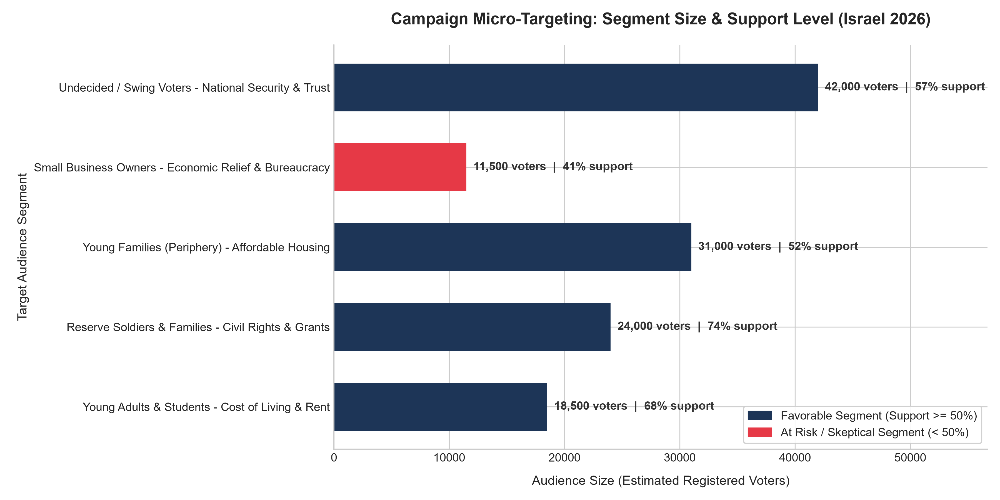

# AI-Driven Campaign Micro-Targeting & Voter Segmentation

פרויקט גמר יישומי המשלב מתודולוגיות של מדעי הנתונים (Data Science) לצד בינה מלאכותית יוצרת (Generative AI) לניהול מערכות תקשורת פוליטית ואופטימיזציית תקציבי קמפיין.

---

## 👥 מגישות הפרויקט
* **יעלת חן פרידמן**
* **עדי ניקול זכרוב**

---

## 🎯 מטרת הפרויקט
הדגמת הוכחת היתכנות (PoC) למעבר מקמפיין מסורתי המבוסס על מסרים כלליים ואחידים (Broadcasting), לקמפיין מיקרו-טרגטינג מבוסס נתונים.  
המערכת מנתחת סגמנטים של בוחרים בישראל, מחשבת כדאיות השקעה לכל קהל (חלוקה לאסטרטגיית GOTV מול שכנוע קולות צפים), ומתאימה קריאייטיב וידאו אישי לכל פלח אוכלוסייה בהתאם לנושאים המעסיקים אותו ביומיום.

---

## 🏗️ ארכיטקטורת המערכת(Pipeline)
1. **אפיון דרישות (PRD):** הגדרת סגמנטים ריאליסטיים בנוף הישראלי, נושאי ליבה ומדדי הצלחה.
3. **מודול אנליטי בפייתון (`campaign_ai.py`):** סימולציית נתוני בוחרים, חישוב אחוזי תמיכה ורינדור תרשים תעדוף תקציבי (`voter_analysis_chart.png`).
4. **יצירת תוכן ב-Gen-AI (`microtargeting_demo.mp4`):** הפקת רצף וידאו רציף (One-Shot) המדגים את התאמת המועמד, שפת הגוף והמסר לשלושה קהלים שונים.
5. **מצגת אינטראקטיבית חיה (`presentation_app.py`):** ממשק Web חי ב-Streamlit הכולל 10 שקפים אקדמיים, גרף חי וסימולטור שינוי תקציב אינטראקטיבי.
6. **בקרת גרסאות ותיעוד ב-GitHub:** ניהול שיתופי, היסטוריית קומיטים מתועדת ויומן פרומפטים שקוף (`prompts_log.md`).

<p>▶️ <a href="microtargeting_demo.mp4">לחצו כאן לצפייה ישירה בסרטון ההדגמה</a></p>
---

## 📂 מבנה המאגר (Repository Structure)
* `presentation_app.py` - אפליקציית המצגת האינטראקטיבית הראשית (Streamlit).
* `campaign_ai.py` - סקריפט פייתון להרצת ניתוח הנתונים ויצירת הגרף.
* `voter_analysis_chart.png` - תרשים הנתונים האנליטי ברזולוציה גבוהה.
* `microtargeting_demo.mp4` - סרטון ה-AI המדגים את התאמת המסרים לקהלי היעד.
* `PRD.md` - מסמך אפיון הדרישות המלא של הקמפיין והסגמנטים.
* `prompts_log.md` - תיעוד שקוף של כלל הפרומפטים ששימשו לאפיון, לקוד ולווידאו.
* `requirements.txt` - רשימת ספריות הפייתון הנדרשות להרצה.
* `README.md` - מדריך הפרויקט והתיעוד הטכני.

---

## 🚀 הוראות הרצה למצגת (Instructions for Evaluator / Agents)

להרצת המצגת האינטראקטיבית החיה בסביבה מקומית:

1. **שכפול המאגר והתקנת תלויות:**
```bash
pip install -r requirements.txt
